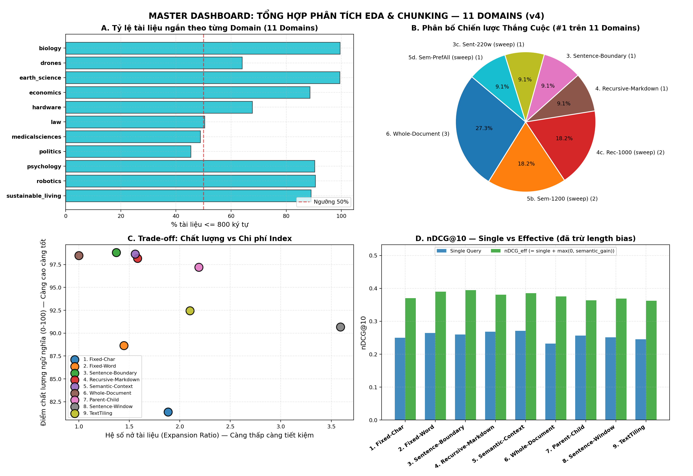
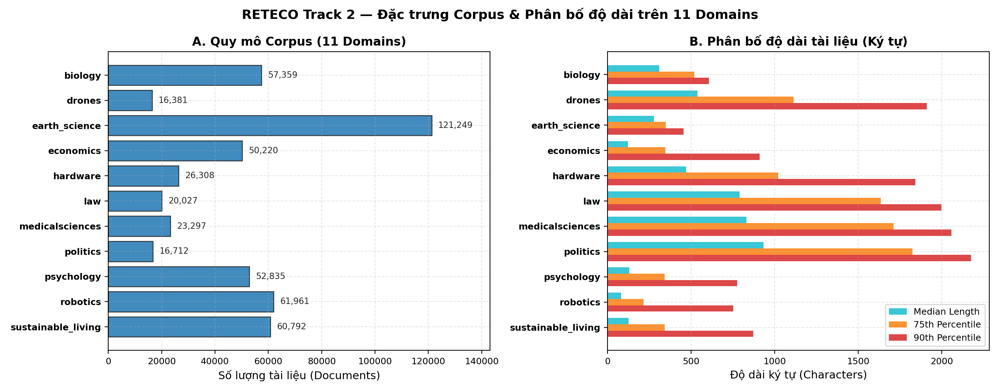
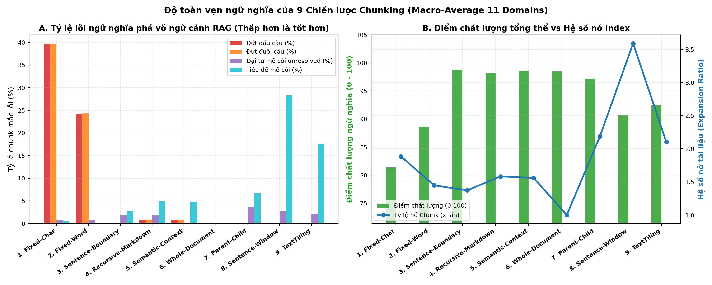
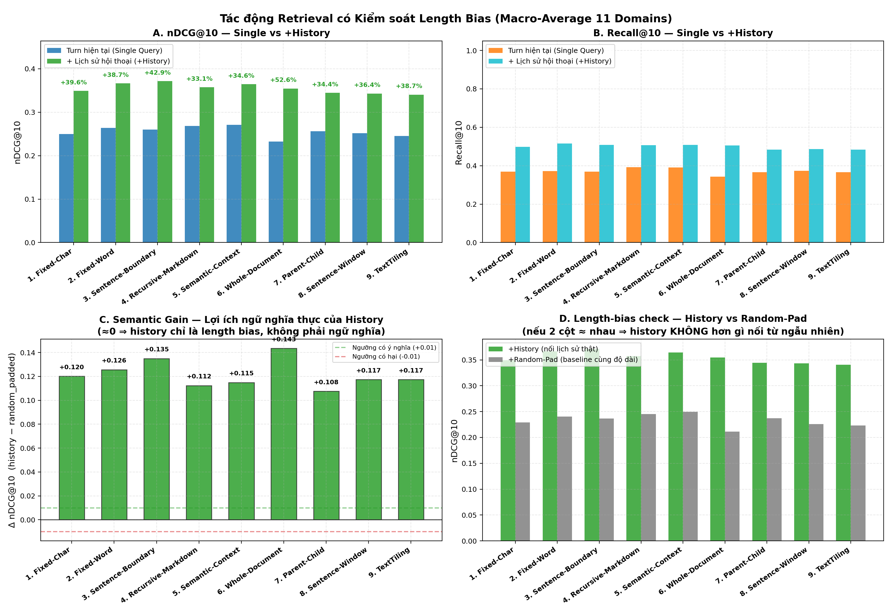
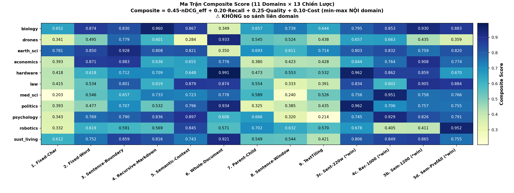
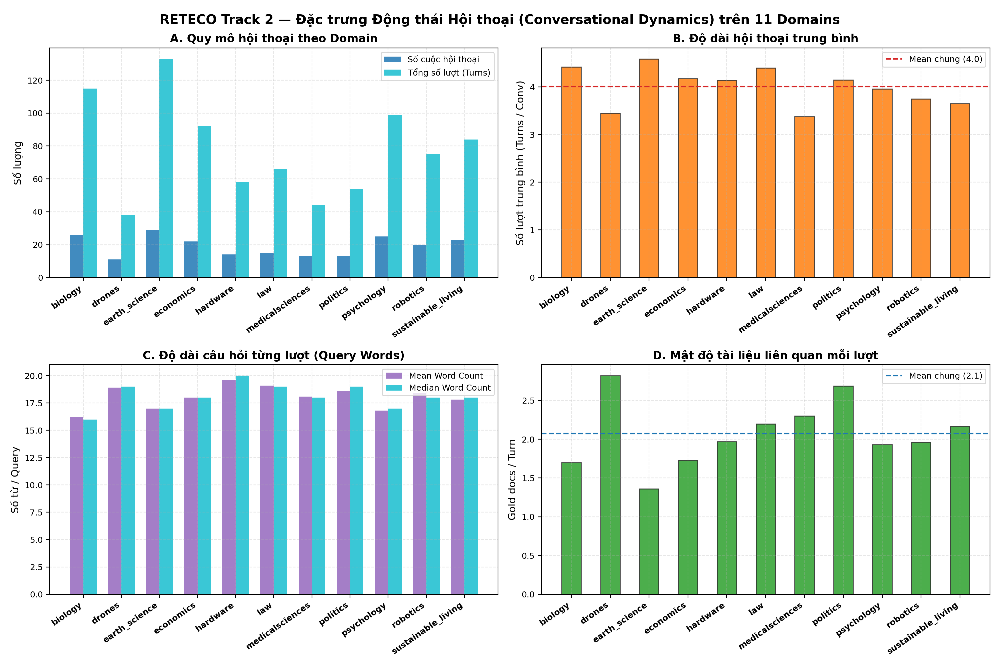

# Báo Cáo Phân Tích Thực Nghiệm & Trực Quan Hóa Chunking — RETECO Track 2 (v4)

- **Thời điểm khởi tạo:** `2026-11-20 23:38:33`
- **Số domains:** `11` (`biology, drones, earth_science, economics, hardware, law, medicalsciences, politics, psychology, robotics, sustainable_living`)
- **Tổng tài liệu:** `507,141`

## 1. Master Overview Dashboard

### Tóm lược phát hiện (dựa trên số liệu):

1. **Phân bố độ dài:** Median trung bình = `418.5` ký tự. Ngắn nhất: `robotics` (median=81); dài nhất: `politics` (median=934).
2. **Phân bố chiến lược thắng:** `6. Whole-Document`: 3/11 (27.3%), `5b. Sem-1200`: 2/11 (18.2%), `4c. Rec-1000`: 2/11 (18.2%), `4. Recursive-Markdown`: 1/11 (9.1%), `3. Sentence-Boundary`: 1/11 (9.1%), `3c. Sent-220w`: 1/11 (9.1%), `5d. Sem-PrefAll`: 1/11 (9.1%).
3. **Length-bias analysis:** nDCG@10 trung bình: single=`0.2554`, +History=`0.3546`, +Random-Pad=`0.2330`. → **Δ Semantic (history − random-pad) = `+0.1215`**. nDCG_eff dùng trong composite = `0.3770`.
   > ✅ **Δ Semantic > 0** — history thực sự mang lại lợi ích ngữ nghĩa vượt qua baseline random-pad cùng độ dài.

## 2. Bảng Tổng Hợp Chiến Lược #1 Theo Domain

| Domain | Docs | Median (c) | % ≤ 800c | Chiến lược #1 | Composite |
| :--- | ---: | ---: | ---: | :--- | ---: |
| **biology** | 57,359 | 309 | 99.48% | `4. Recursive-Markdown` | **0.9598** |
| **drones** | 16,381 | 537 | 64.01% | `6. Whole-Document` | **0.9334** |
| **earth_science** | 121,249 | 278 | 99.46% | `3. Sentence-Boundary` | **0.9280** |
| **economics** | 50,220 | 120 | 88.56% | `5b. Sem-1200` | **0.9077** |
| **hardware** | 26,308 | 469 | 67.72% | `6. Whole-Document` | **0.9914** |
| **law** | 20,027 | 791 | 50.44% | `5b. Sem-1200` | **0.9046** |
| **medicalsciences** | 23,297 | 830 | 48.85% | `4c. Rec-1000` | **0.9506** |
| **politics** | 16,712 | 934 | 45.38% | `3c. Sent-220w` | **0.9619** |
| **psychology** | 52,835 | 130 | 90.34% | `4c. Rec-1000` | **0.9286** |
| **robotics** | 61,961 | 81 | 90.53% | `5d. Sem-PrefAll` | **0.9524** |
| **sustainable_living** | 60,792 | 125 | 88.99% | `6. Whole-Document` | **0.9210** |

> ⚠️ **Lưu ý thang điểm:** Composite được chuẩn hóa min-max **trong từng domain**. Composite=0.80 ở `earth_science` KHÔNG có nghĩa tốt hơn composite=0.72 ở `biology` — chỉ có nghĩa chiến lược đó vượt trội các đối thủ **trong cùng domain**.

---

## 3. Khảo Sát Đặc Trưng Corpus

- **Domain có đuôi dài** (P90 > 1,500c, nguy cơ truncation cao nếu Whole_Document): `drones, hardware, law, medicalsciences, politics`.
- **Domain ngắn gọn** (P90 ≤ 1,500c): `biology, earth_science, economics, psychology, robotics, sustainable_living`.

## 4. Đo Lường Lỗi Ngữ Nghĩa của Chunking

### Phân tích nguyên nhân lỗi kỹ thuật:
- **`1_Fixed_Char` & `2_Fixed_Word`:** Đứt câu cao nhất do cắt chuỗi theo độ dài cơ học.
- **`4_Recursive_Markdown`:** Phân rã phân cấp + cơ chế hoãn tiêu đề mồ côi (`carry = cur.pop()`).
- **`5_Semantic_Context_Injected`:** Tiêm prefix `[Document Topic: ...]` để giảm đại từ mồ côi.
- **`6_Whole_Document`:** Không đứt câu nhân tạo, nhưng `over_token_limit_pct` cao ở domain dài.

## 5. Hiệu Năng Truy Hồi (BM25 + Length-Bias Control)

**So sánh data-driven giữa các chiến lược chính:**

| Chiến lược | nDCG single | nDCG +Hist | Δ Semantic | nDCG_eff |
| :--- | ---: | ---: | ---: | ---: |
| 3. Sentence-Boundary | 0.2599 | 0.3714 | +0.1350 | 0.3949 |
| 4. Recursive-Markdown | 0.2684 | 0.3574 | +0.1123 | 0.3808 |
| 6. Whole-Document | 0.2323 | 0.3546 | +0.1435 | 0.3758 |
| 7. Parent-Child | 0.2563 | 0.3446 | +0.1075 | 0.3639 |
| 5. Semantic-Context | 0.2708 | 0.3644 | +0.1150 | 0.3857 |

> Δ Semantic ≈ 0 (không có mũi tên) ⇒ history chỉ là length bias; nếu Δ Semantic > 0 ⇒ history thực sự giúp. `nDCG_eff = single + max(0, Δ Semantic)` là metric dùng trong composite.

## 6. Ma Trận Composite (Domain × Strategy)

> Ô xám `N/A` = chiến lược không được chạy trong domain đó. Composite NỘI domain (min-max) — không so sánh liên domain.

## 7. Đặc Tính Hội Thoại

- Số turns/conv, độ dài query, gold docs/turn — đầu vào cho bước thiết kế Query Rewriter.
