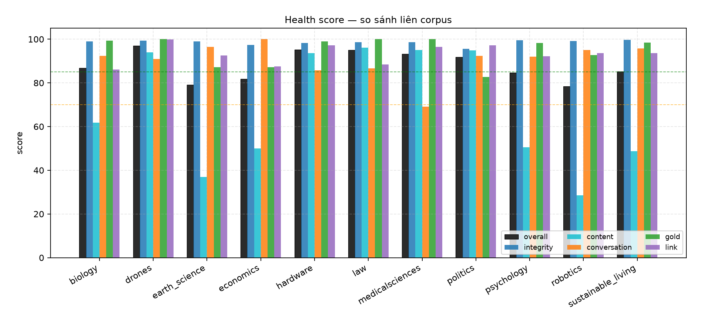
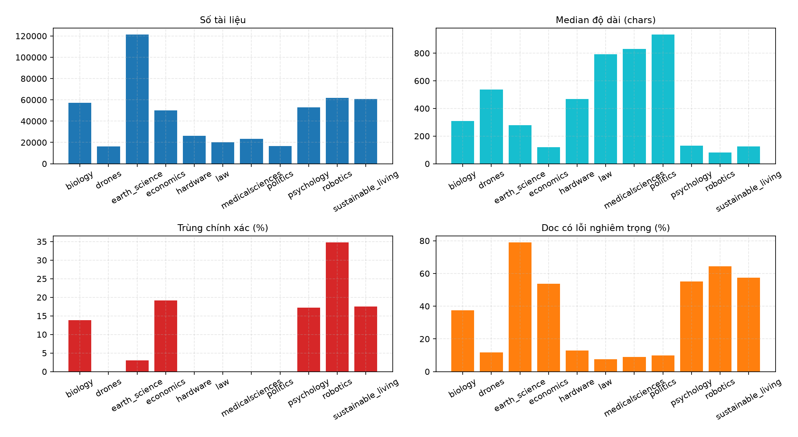
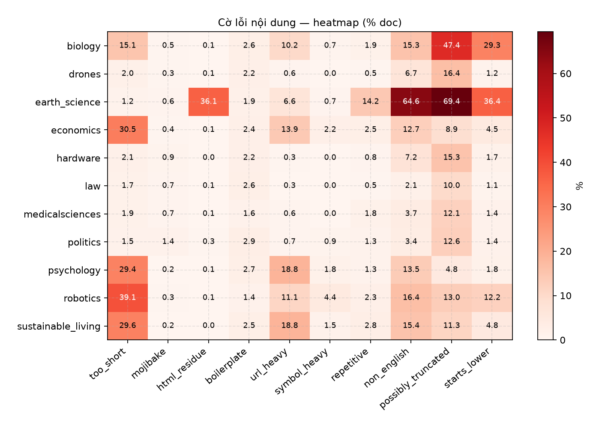
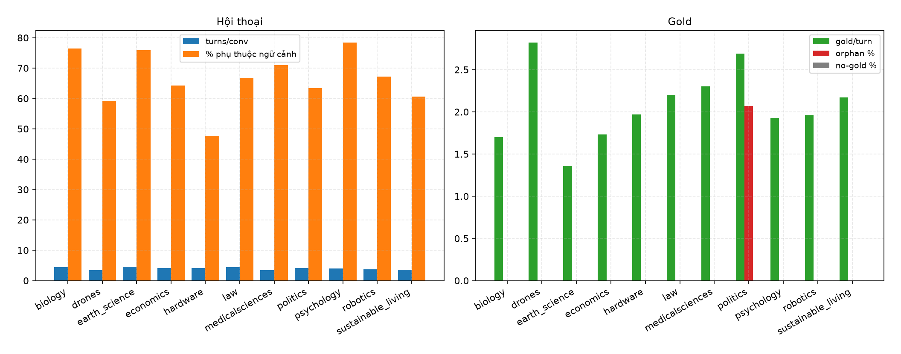
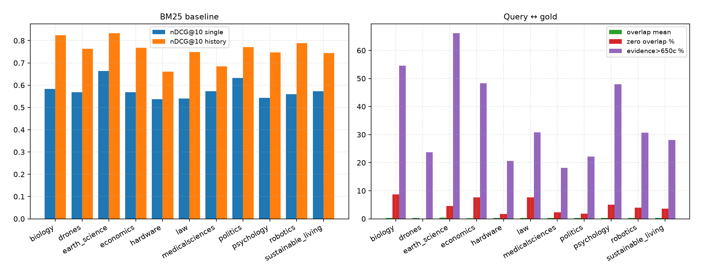

# RETECO Track 2 — Data Quality Summary

*Tạo lúc 2026-11-21T09:08:25*
*Số domain: 11*

## 📊 Biểu đồ so sánh liên corpus

## Health tổng hợp

| Domain | Overall | integrity | content | conversation | gold | link |
| :--- | ---: | ---: | ---: | ---: | ---: | ---: |
| biology | 86.9 🟢 | 99.0 🟢 | 61.8 🔴 | 92.3 🟢 | 99.4 🟢 | 86.1 🟢 |
| drones | 97.0 🟢 | 99.3 🟢 | 93.9 🟢 | 90.9 🟢 | 100.0 🟢 | 99.9 🟢 |
| earth_science | 79.1 🟡 | 98.9 🟢 | 36.9 🔴 | 96.5 🟢 | 87.1 🟢 | 92.6 🟢 |
| economics | 81.9 🟡 | 97.3 🟢 | 50.0 🔴 | 100.0 🟢 | 87.1 🟢 | 87.6 🟢 |
| hardware | 95.3 🟢 | 98.3 🟢 | 93.7 🟢 | 85.7 🟢 | 99.0 🟢 | 97.2 🟢 |
| law | 95.1 🟢 | 98.7 🟢 | 96.2 🟢 | 86.7 🟢 | 100.0 🟢 | 88.5 🟢 |
| medicalsciences | 93.3 🟢 | 98.6 🟢 | 95.0 🟢 | 69.2 🔴 | 100.0 🟢 | 96.5 🟢 |
| politics | 91.9 🟢 | 95.5 🟢 | 94.8 🟢 | 92.3 🟢 | 82.7 🟡 | 97.2 🟢 |
| psychology | 84.7 🟡 | 99.5 🟢 | 50.6 🔴 | 92.0 🟢 | 98.2 🟢 | 92.1 🟢 |
| robotics | 78.5 🟡 | 99.1 🟢 | 28.6 🔴 | 95.0 🟢 | 92.8 🟢 | 93.6 🟢 |
| sustainable_living | 85.2 🟢 | 99.7 🟢 | 48.7 🔴 | 95.7 🟢 | 98.5 🟢 | 93.7 🟢 |

## Metrics chính theo domain

| Domain | Docs | Median(c) | Dup% | Deps% | Gold/turn | Overlap | nDCG(s) | nDCG(h) |
| :--- | ---: | ---: | ---: | ---: | ---: | ---: | ---: | ---: |
| biology | 57359 | 309.0 | 13.82 | 76.4 | 1.7 | 0.361 | 0.5837 | 0.8238 |
| drones | 16381 | 537.0 | 0.0 | 59.26 | 2.82 | 0.345 | 0.5684 | 0.7634 |
| earth_science | 121249 | 278.0 | 2.98 | 75.96 | 1.36 | 0.422 | 0.6634 | 0.8336 |
| economics | 50220 | 120.0 | 19.17 | 64.29 | 1.73 | 0.244 | 0.5686 | 0.7682 |
| hardware | 26308 | 469.0 | 0.0 | 47.73 | 1.97 | 0.309 | 0.5367 | 0.66 |
| law | 20027 | 791.0 | 0.0 | 66.67 | 2.2 | 0.288 | 0.54 | 0.7478 |
| medicalsciences | 23297 | 830.0 | 0.0 | 70.97 | 2.3 | 0.282 | 0.5725 | 0.6846 |
| politics | 16712 | 934.0 | 0.0 | 63.41 | 2.69 | 0.312 | 0.6319 | 0.7709 |
| psychology | 52835 | 130.0 | 17.18 | 78.38 | 1.93 | 0.319 | 0.5427 | 0.7472 |
| robotics | 61961 | 81.0 | 34.75 | 67.27 | 1.96 | 0.303 | 0.5593 | 0.7894 |
| sustainable_living | 60792 | 125.0 | 17.52 | 60.66 | 2.17 | 0.272 | 0.5727 | 0.7434 |

## Khuyến nghị chính theo domain

### biology

- **[medium]** 0.5% doc có dấu hiệu lỗi encoding.
- **[medium]** Rỗng 0.0% / quá ngắn 15.1%.
- **[medium]** Trùng chính xác 13.82%.
- **[medium]** Gần trùng 4.24% (MinHash).
- **[low]** 15.3% doc nghi không phải tiếng Anh.
- **[low]** Có email/SĐT trong corpus -> cân nhắc ẩn danh.
- **[high]** 76.4% turn sau turn đầu phụ thuộc ngữ cảnh -> cần query rewriter.
- **[medium]** 2 hội thoại có đại từ/liên từ ở turn đầu.

### drones

- **[medium]** 0.35% doc có dấu hiệu lỗi encoding.
- **[medium]** Rỗng 0.0% / quá ngắn 2.03%.
- **[low]** 6.72% doc nghi không phải tiếng Anh.
- **[high]** 59.26% turn sau turn đầu phụ thuộc ngữ cảnh -> cần query rewriter.
- **[medium]** 1 hội thoại có đại từ/liên từ ở turn đầu.

### earth_science

- **[medium]** 0.55% doc có dấu hiệu lỗi encoding.
- **[medium]** Rỗng 0.0% / quá ngắn 1.23%.
- **[medium]** Trùng chính xác 2.98%.
- **[medium]** Gần trùng 2.61% (MinHash).
- **[medium]** Boilerplate 1.94% / HTML sót 36.06%.
- **[low]** 64.59% doc nghi không phải tiếng Anh.
- **[low]** Có email/SĐT trong corpus -> cân nhắc ẩn danh.
- **[high]** 75.96% turn sau turn đầu phụ thuộc ngữ cảnh -> cần query rewriter.

### economics

- **[medium]** 0.4% doc có dấu hiệu lỗi encoding.
- **[medium]** Rỗng 0.0% / quá ngắn 30.54%.
- **[medium]** Trùng chính xác 19.17%.
- **[low]** 12.66% doc nghi không phải tiếng Anh.
- **[low]** Có email/SĐT trong corpus -> cân nhắc ẩn danh.
- **[high]** 64.29% turn sau turn đầu phụ thuộc ngữ cảnh -> cần query rewriter.
- **[medium]** 25.71% gold doc có lỗi nội dung nghiêm trọng.
- **[medium]** 7.61% turn gold KHÔNG chia sẻ từ nào với query.

### hardware

- **[medium]** 0.87% doc có dấu hiệu lỗi encoding.
- **[medium]** Rỗng 0.0% / quá ngắn 2.14%.
- **[low]** 7.15% doc nghi không phải tiếng Anh.
- **[high]** 47.73% turn sau turn đầu phụ thuộc ngữ cảnh -> cần query rewriter.
- **[medium]** 2 hội thoại có đại từ/liên từ ở turn đầu.

### law

- **[medium]** 0.66% doc có dấu hiệu lỗi encoding.
- **[medium]** Rỗng 0.0% / quá ngắn 1.69%.
- **[low]** 2.1% doc nghi không phải tiếng Anh.
- **[low]** Có email/SĐT trong corpus -> cân nhắc ẩn danh.
- **[high]** 66.67% turn sau turn đầu phụ thuộc ngữ cảnh -> cần query rewriter.
- **[medium]** 2 hội thoại có đại từ/liên từ ở turn đầu.
- **[medium]** 7.58% turn gold KHÔNG chia sẻ từ nào với query.

### medicalsciences

- **[medium]** 0.69% doc có dấu hiệu lỗi encoding.
- **[medium]** Rỗng 0.0% / quá ngắn 1.85%.
- **[low]** 3.68% doc nghi không phải tiếng Anh.
- **[low]** Có email/SĐT trong corpus -> cân nhắc ẩn danh.
- **[high]** 70.97% turn sau turn đầu phụ thuộc ngữ cảnh -> cần query rewriter.
- **[medium]** 4 hội thoại có đại từ/liên từ ở turn đầu.

### politics

- **[medium]** 1.39% doc có dấu hiệu lỗi encoding.
- **[medium]** Rỗng 0.0% / quá ngắn 1.5%.
- **[low]** 3.42% doc nghi không phải tiếng Anh.
- **[low]** Có email/SĐT trong corpus -> cân nhắc ẩn danh.
- **[high]** 63.41% turn sau turn đầu phụ thuộc ngữ cảnh -> cần query rewriter.
- **[medium]** 1 hội thoại có đại từ/liên từ ở turn đầu.
- **[high]** 3 cặp gold trỏ tới doc KHÔNG có trong corpus.
- **[high]** 3 turn có gold inline KHÁC qrels.

### psychology

- **[medium]** 0.23% doc có dấu hiệu lỗi encoding.
- **[medium]** Rỗng 0.0% / quá ngắn 29.4%.
- **[medium]** Trùng chính xác 17.18%.
- **[medium]** Gần trùng 1.4% (MinHash).
- **[low]** 13.51% doc nghi không phải tiếng Anh.
- **[low]** Có email/SĐT trong corpus -> cân nhắc ẩn danh.
- **[high]** 78.38% turn sau turn đầu phụ thuộc ngữ cảnh -> cần query rewriter.
- **[medium]** 2 hội thoại có đại từ/liên từ ở turn đầu.

### robotics

- **[medium]** 0.31% doc có dấu hiệu lỗi encoding.
- **[medium]** Rỗng 0.0% / quá ngắn 39.15%.
- **[medium]** Trùng chính xác 34.75%.
- **[medium]** Gần trùng 1.54% (MinHash).
- **[low]** 16.41% doc nghi không phải tiếng Anh.
- **[high]** 67.27% turn sau turn đầu phụ thuộc ngữ cảnh -> cần query rewriter.
- **[medium]** 1 hội thoại có đại từ/liên từ ở turn đầu.
- **[medium]** 14.49% gold doc có lỗi nội dung nghiêm trọng.

### sustainable_living

- **[medium]** 0.17% doc có dấu hiệu lỗi encoding.
- **[medium]** Rỗng 0.0% / quá ngắn 29.63%.
- **[medium]** Trùng chính xác 17.52%.
- **[medium]** Gần trùng 1.04% (MinHash).
- **[low]** 15.44% doc nghi không phải tiếng Anh.
- **[low]** Có email/SĐT trong corpus -> cân nhắc ẩn danh.
- **[high]** 60.66% turn sau turn đầu phụ thuộc ngữ cảnh -> cần query rewriter.
- **[medium]** 1 hội thoại có đại từ/liên từ ở turn đầu.
